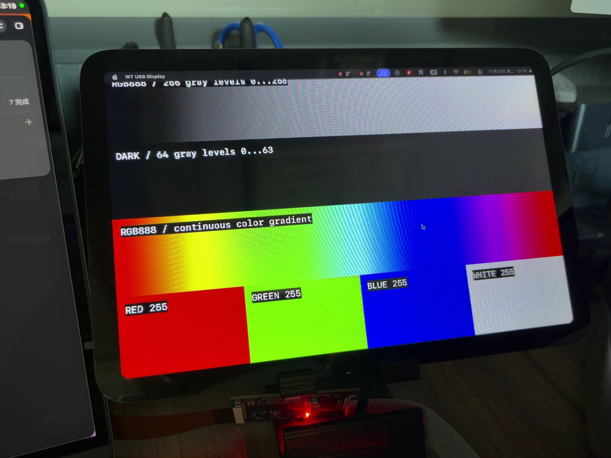
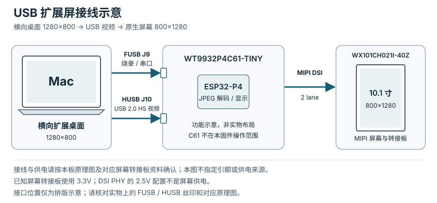
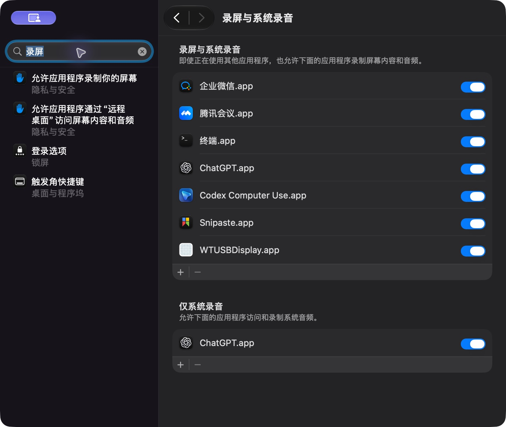
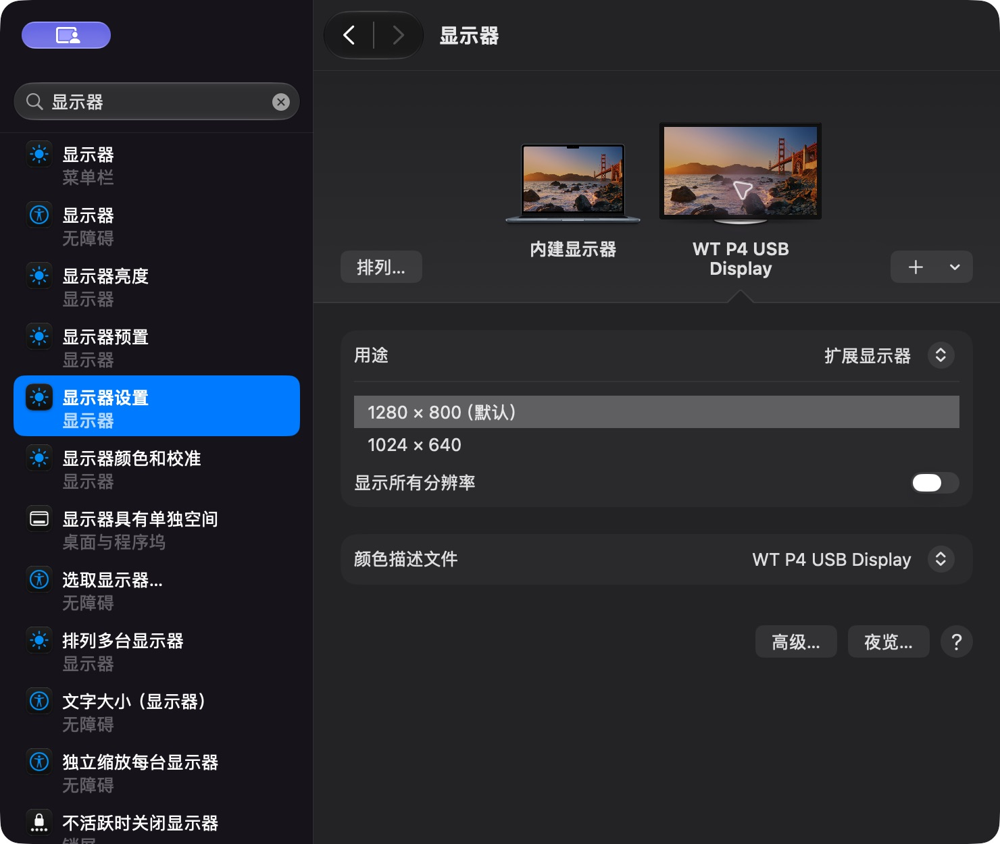

# WT_USB_Display

基于 **WT9932P4C61-TINY（ESP32-P4）+ 10.1寸 MIPI 屏** 的 USB 副屏工程。
Mac App 创建真正的 **1280×800 系统扩展桌面**，通过 USB2.0 High-Speed 发送 JPEG，
P4 硬件解码后驱动原生800×1280面板。窗口可通过macOS移入副屏。



*手机后置实拍：RGB888链路显示灰阶、暗部渐变和主色块；照片不是色深计量或光学帧率证明。*

## 工程入口

| 内容 | 目录与说明 |
| --- | --- |
| ESP-IDF 固件 | [firmware/README.md](firmware/README.md)：接线、构建、烧录、协议及各测试配置 |
| macOS App | [host/macos/README.md](host/macos/README.md)：依赖、构建、录屏授权及使用截图 |
| Windows 扩展桌面验证 | 构建投送工具、启动副屏和用 UVC 摄像头测帧率，见 [Windows 验证说明](scripts/windows/README.md) |
| 协作指引 | [AGENTS.md](AGENTS.md)，另提供 [agent.md](agent.md) 入口 |

```text
firmware/          ESP-IDF 6.0.2工程、固定配置与依赖锁
host/macos/        Swift/AppKit上位机与离线检查
scripts/           构建、串口分析和性能验证工具
docs/assets/       必要的接线图、真实界面截图与实拍
```

仓库只纳入这两个源码工程及配套工具/文档。构建产物、托管组件、SDK、原始录像、下载资料、
本机日志和临时诊断草稿均由 `.gitignore` 排除，不需要下载这些内容才能构建。

## 硬件与连接

已适配 **WT9932P4C61-TINY / ESP32-P4 v3.2 / 16MB Flash / 32MB HEX PSRAM**，
屏幕为沃乐康 **WX101CH021I-40Z（JD9366TC款）**。其他同尺寸或同系列控制器不保证兼容。



- FUSB用于P4烧录与串口监控；HUSB用于High-Speed视频，两者用途不同。
- 本屏配套转接板已核对为3.3V输入；接线前以实际板卡原理图和针序为准，勿将其接入5V。
- 当前程序不操作C61，USB副屏模式不提供触摸回传或音频。

## 快速开始

### 1. 构建并烧录固件

安装并激活ESP-IDF **6.0.2**。按[固件快速开始](firmware/README.md#快速开始直接使用-esp-idf)
选择 `usb_display` 配置，使用FUSB烧录并确认启动日志出现RGB888/BGR24与三个扫描缓冲。

已配置仓库所需espvm环境时，也可从仓库根目录构建：

```sh
WT_SCREEN_PROFILE=usb_display bash scripts/build_firmware.sh
```

该脚本只构建，不自动烧录；未指定profile时默认 `probe`，不显示USB视频。

### 2. 构建 Mac App

在Mac上安装Xcode Command Line Tools、libusb与pkg-config，然后运行：

```sh
bash host/macos/build.sh --test
open host/macos/build/WTUSBDisplay.app --args --fps 60 --quality 0.72
```

依赖安装、App路径、首次授权及参数详见[App README](host/macos/README.md)。
录屏授权必须授予实际启动的当前App；命令行检查成功不能代替正常App身份授权。

### 3. 授权并使用扩展桌面

在“系统设置 → 隐私与安全 → 录屏与系统录音”的上方列表开启 `WTUSBDisplay.app`。
若未出现，点击添加并选择已构建的App，再按系统提示重新打开它。



系统“显示器”页面应看到 **WT P4 USB Display / 扩展显示器 / 1280×800**。



将窗口移入该扩展屏即可使用。退出App会移除虚拟显示器，由macOS重新安置其上的窗口。

## 当前链路与验证边界

- 输入1280×800，真实像素逆时针旋转到800×1280，baseline JPEG默认质量0.72。
- P4直接硬解RGB888/BGR24，三帧缓冲合计9,216,000B；DSI为2 lane × 1000Mbps、RGB888。
- 单台M5 Mac的固定动态图短测：正常App约 **57.24呈现ACK FPS / 27.01% App CPU**；CPU100%表示一核。
  这是特定场景的参考值，60FPS是请求，ACK不是独立光学帧率，JPEG仍有损。
- 仅完成本机短时验证；USB触摸、长期负载、物理热插拔和其他系统/主机仍需验证。
- Mac虚拟屏依赖未公开的CoreGraphics接口；App动态链接本机libusb。macOS兼容性与分发需另行核验。

## 来源与许可

面板初始化及相关代码保留GPL-2.0标记和上游版权，见
[固件来源与许可](firmware/README.md#来源与许可)及[COPYING.GPL-2.0](firmware/COPYING.GPL-2.0)。
Mac虚拟屏参考glint，保留[MIT许可](host/macos/GLINT-LICENSE)与
[第三方说明](host/macos/THIRD_PARTY_NOTICES.md)。托管组件和libusb适用各自许可。
