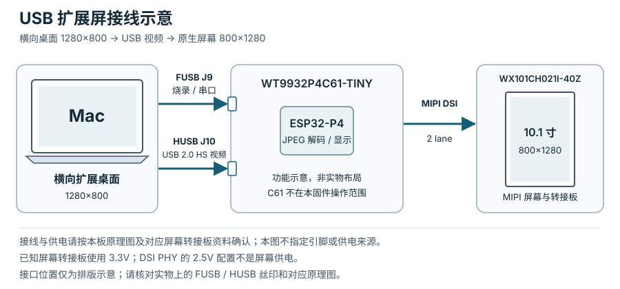
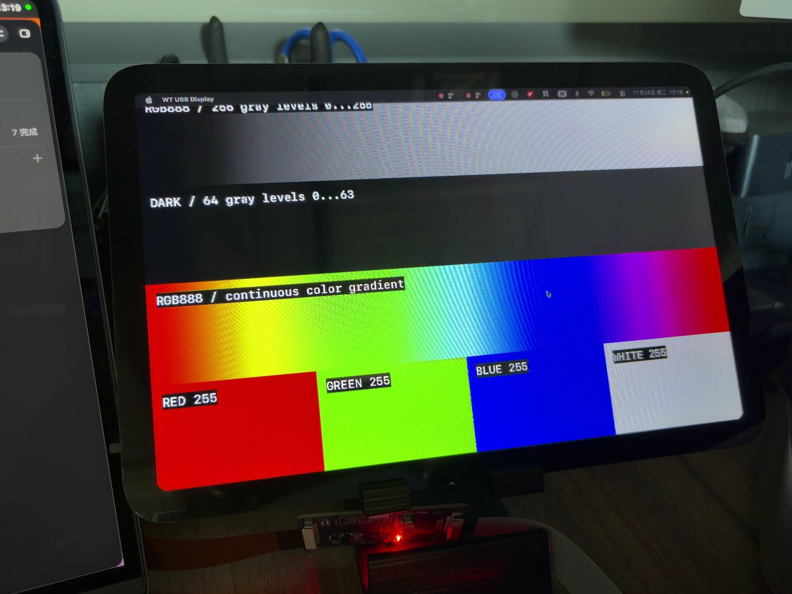

# WT_USB_Display 固件

面向 **WT9932P4C61-TINY + WX101CH021I-40Z** 的独立 ESP-IDF 工程。主要用途是接收配套 Mac 程序发送的 JPEG，在 MIPI 屏上显示扩展桌面。首次使用优先选择下面的 `usb_display` 配置；它需要配套主机程序，主机端说明见 [macOS README](../host/macos/README.md)。

## 硬件与连接

| 项目 | 本项目配置 |
| --- | --- |
| 开发板 | WT9932P4C61-TINY，ESP32-P4 v3.2、16MB Flash、32MB HEX PSRAM |
| 屏幕 | 沃乐康 WX101CH021I-40Z，800×1280，JD9366/JD9366TC 系列，配套15pin连接/转接板 |
| 工具链 | **ESP-IDF 6.0.2**；源码会拒绝其他IDF版本和芯片目标 |
| 显示链路 | 2 lane × 1000Mbps，DPI 80MHz，DSI输出RGB888 |
| 触摸接线 | I2C0，SDA=GPIO7、SCL=GPIO8；0x68、芯片ID 0x9032 |

- **FUSB**：USB Serial/JTAG，用于烧录、串口监控和调试。
- **HUSB**：USB2.0 High-Speed OTG，用于主机向屏幕发送视频；USB视频模式下是设备端。
- 调试视频时可同时连接两个口。烧录命令中的串口必须对应FUSB，不能用HUSB视频接口代替。



已验证的配套15pin屏转接板由 **3.3V输入** 供电；连接前核对实际转接板版本、针序及电源能力，不向该3.3V输入接5V。DSI PHY使用板内LDO3的2.5V，和屏幕供电是两回事。本工程未配置未知背光或硬件复位GPIO，使用DCS软件复位。其他屏幕/转接板不能只凭尺寸或JD9366名称视为兼容。

## 快速开始：直接使用 ESP-IDF

先安装并激活ESP-IDF **6.0.2**，确认 `idf.py --version`。将仓库克隆到**纯ASCII路径**；部分工具链在中文路径下生成参数会失败。

```sh
git clone https://github.com/Wireless-TAG-Maker/WT_USB_Display.git
cd WT_USB_Display/firmware
idf.py --version
IDF_TARGET=esp32p4 idf.py -B build-usb_display \
  -D "SDKCONFIG=$PWD/build-usb_display/sdkconfig" \
  -D 'SDKCONFIG_DEFAULTS=sdkconfig.defaults;sdkconfig.display;sdkconfig.usb_display' build
```

每个profile使用独立的构建目录和 `SDKCONFIG`。已有sdkconfig时，defaults不会强制覆盖它；重新应用默认配置时使用新的构建目录及配置路径。配置叠加关系见下表。

将 `FUSB_PORT` 替换为实际FUSB串口，例如macOS的 `/dev/cu.usbmodem…` 或Linux的 `/dev/ttyACM…`：

```sh
IDF_TARGET=esp32p4 idf.py -B build-usb_display \
  -D "SDKCONFIG=$PWD/build-usb_display/sdkconfig" \
  -D 'SDKCONFIG_DEFAULTS=sdkconfig.defaults;sdkconfig.display;sdkconfig.usb_display' \
  -p FUSB_PORT flash monitor
```

`flash`使用该次构建的bootloader、分区表和应用。退出monitor通常为 `Ctrl+]`。烧录后若仍停在下载模式，可退出monitor后按复位键或重新上电，再检查启动日志。

## 仓库构建脚本：已安装 espvm 时

从仓库根目录运行：

```sh
WT_SCREEN_PROFILE=usb_display bash scripts/build_firmware.sh
```

脚本依赖本机**预先安装**的espvm、ESP-IDF6.0.2及对应Python环境；不负责安装它们。默认查找 `$HOME/.espvm`，可通过 `ESPVM_DIR` 指定其他安装根目录，目录内需有：

```text
espvm.sh
esp-idf/versions/v6.0.2/esp-idf/export.sh
esp-idf/versions/v6.0.2/tools/python_env/idf6.0_py*_env/bin/python
```

脚本将源码复制到 `/tmp` 下的ASCII临时目录，重新生成配置并构建，不使用原目录的sdkconfig或build。产物写入本机生成的 `outputs/<profile>/`，包含BIN、ELF、配置、烧录参数和SHA256清单；**脚本不烧录**。未设置 `WT_SCREEN_PROFILE` 时默认是 `probe`。

脚本构建后，可在已激活的同版本IDF环境中使用生成的参数文件：

```sh
cd outputs/usb_display
python -m esptool --chip esp32p4 --port FUSB_PORT write-flash @flash_args
python -m esp_idf_monitor --target esp32p4 --port FUSB_PORT wt_p4c61_screen_probe.elf
```

## 全部构建配置

表中短名代表对应的 `sdkconfig.<短名>` 文件，按从左到右的顺序叠加。

| Profile | 默认配置链 | 用途 |
| --- | --- | --- |
| `usb_display` | defaults → display → usb_display | 推荐入口；HUSB JPEG视频、RGB888三缓冲，不启动LVGL/触摸 |
| `probe` | defaults | 默认诊断；仅扫描I2C，不启用屏幕或PSRAM |
| `display` | defaults → display | RGB888单缓冲静态彩条 |
| `benchmark` | defaults → display → benchmark | LVGL8官方benchmark，RGB565单缓冲 |
| `touch` | defaults → display → benchmark → touch | 本地触摸测试及benchmark按钮，RGB565 |
| `latency` | defaults → display → benchmark → touch → latency | 触摸测试加GPIO51 WS2812/LCD时标，用于相机诊断 |

脚本用 `WT_SCREEN_PROFILE=<profile>` 选择；直接IDF构建则替换构建目录、SDKCONFIG路径和完整defaults文件列表。不要把benchmark/touch配置叠加进USB配置。

组件版本固定在 [main/idf_component.yml](main/idf_component.yml)：LVGL **8.4.0**、led_strip **3.0.3**、esp_tinyusb **2.3.0**、tinyusb **0.21.0~6**。首次构建需要联网下载托管依赖；当前所有profile都会解析这些依赖。

## USB视频链路与内存

```text
Mac扩展桌面1280×800 → 像素旋转/JPEG 800×1280 → HUSB vendor bulk
→ P4硬件JPEG直接解码BGR24 → RGB888三缓冲 → DSI RGB888 → 面板
```

JPEG直接解码为 **RGB888/BGR24**，低地址字节顺序为B、G、R，不经过RGB565中间量化。DPI输入与解码输出相同，DSI线上仍为24位RGB888。

| 缓冲 | 大小 |
| --- | --- |
| 单帧800×1280×3 | **3,072,000B**，行跨度 **2400B** |
| 三份扫描帧 | 9,216,000B，约8.79MiB PSRAM |
| 两份JPEG接收缓冲 | 各768KiB，合计1.5MiB PSRAM |

以上主要缓冲约10.29MiB，另需SDK、队列及其他运行内存。显示配置启用200MHz HEX PSRAM与启动内存测试。RGB888帧缓冲读写量比RGB565增加50%；性能还受PSRAM仲裁、JPEG内容和主机影响。

`acquire_frame/release_frame/present_frame` 管理FREE/ACQUIRED/PENDING/FRONT状态。JPEG只写借出的非扫描帧，提交后等刷新边界再回收旧帧；不要将解码目标改成当前扫描帧。

### 主机协议

协议唯一字段定义见 [main/usb_screen_protocol.h](main/usb_screen_protocol.h)：

- 开发测试VID:PID为 **CAFE:4011**；接口0，bulk OUT `0x01`、IN `0x81`。
- 控制请求 `0xC1/0x01` 读取32B `WP4H` HELLO。
- 每帧为32B `WP4D`头加JPEG，所有整数小端，载荷最多768KiB；CRC为IEEE CRC32，与 `zlib crc32(0, …)` 一致。
- JPEG必须是实际800×1280、8位baseline、单扫描YCbCr，分量ID为1/2/3；支持4:4:4/4:2:2/4:2:0。仅修改EXIF方向不能代替像素旋转。
- 每帧传输以短包结束；总长度整除512时必须发送ZLP。工程级 `CFG_TUD_VENDOR_RX_NEED_ZLP=1` 同时作用于TinyUSB库和应用。
- 40B `WP4A` ACK包含接收、解码、呈现累计计数及耗时；状态非0时主机应记录并处理。

`presented_frames` 是固件按本板换帧时序确认的提交计数。SDK没有提供实际扫描帧ID，因此它不替代相机验证；刷新中断、USB字节率也不等于新画面FPS。`decode_us`覆盖SDK解码调用，`present_us`是提交等待时间，都不是端到端显示延迟。

## 触摸、benchmark与边界

USB视频模式目前**不启动触摸，也不向Mac发送HID触摸事件**。`touch`是独立的本地LVGL测试，不能与USB视频功能等同。

触摸以100kHz识别0x68的0x9032，随后尝试400kHz；发送4B地址selector后读取本模组确认的60B报告，仅取第一指800×1280坐标。没有写BackDoor/控制寄存器或未知复位GPIO。0x5A只做地址探测，身份与控制协议未确认。

触摸不提供多点手势或低延迟保证；报告长度、坐标和selector依赖具体模组。发生I2C错误或越界时取消当前按压。`latency`会使用板载GPIO51 WS2812，供物理时序观察，不是触摸固件更新工具。

`benchmark`/`touch`仍使用RGB565单framebuffer，由P4 v3桥扩展为RGB888；LVGL为16位、无字节交换。官方max-speed benchmark共96个用例，Weighted FPS描述渲染/flush能力，不是面板VSYNC FPS。此单缓冲路径未提供防撕裂。

## 性能与启动检查

单台Mac M5、1280×800请求60FPS、固定人工动态图、关闭相机的一次短时控制测试中，RGB888链路的呈现ACK约 **57.24FPS**。这是特定内容与负载的参考值，不承诺任意桌面、主机或线缆下持续60FPS。



实拍用于检查画面与颜色顺序；照片包含相机处理，不能用于证明256个独立物理亮度级或光学FPS。

启动时先打印芯片修订号并扫描SDA7/SCL8的I2C地址，随后初始化显示。USB配置应出现 `RGB888/BGR24`、三份3,072,000B缓冲及USB启动日志。持续检查 `USB_SCREEN` 的CRC/header/decode/present错误、超时和丢弃计数；错误增长时保留完整日志，不仅截取FPS。

若HUSB无视频，依次确认：实际烧录的是 `usb_display`、FUSB日志正常、HUSB使用数据线、主机程序识别CAFE:4011、JPEG几何与协议一致。彩条正常只证明显示初始化，不证明主机视频或触摸已可用。

## 来源与许可

- 面板初始化：精确型号[WX101CH021I-40Z驱动，固定提交cbb9f435](https://github.com/IotaHydrae/panel-dsi-wx101ch021i-40z/blob/cbb9f43598856d1a81f49c7c6c9b7122127a58e0/panel-wx101ch021i-40z.c)。保留92条命令、延时与原始版权；该参考为第三方驱动。
- 触摸selector/事务参考：[OSPTEK JD9366，固定提交e36cd83](https://github.com/osptek/display-tft-10.1inch-800x1280/blob/e36cd83c5d61435ad4286f70caf797a4f0996d80/examples/esp32p4-idf6-jd9366-mipi-lvgl-port-lvgl9/components/esp_lcd_touch_jd9366/esp_lcd_touch_jd9366.c)；其80B长度和控制写入未直接照搬。
- 触摸字段交叉核对：[另一模组Linux提案，固定提交1932bd4](https://github.com/HF-2001/linux/blob/1932bd4b288d671b244acf759726547211fc484f/drivers/input/touchscreen/jadard_jd9365tx.c)。当前60B长度以本模组报告信息为准。

面板相关源码及初始化表保留上游 **GPL-2.0** 标记与版权，许可证见 [COPYING.GPL-2.0](COPYING.GPL-2.0)。托管组件与主机端第三方代码分别保留其各自许可。
