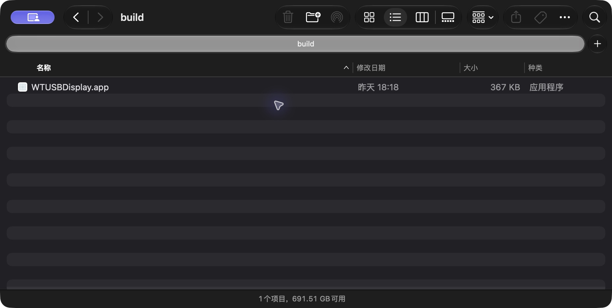
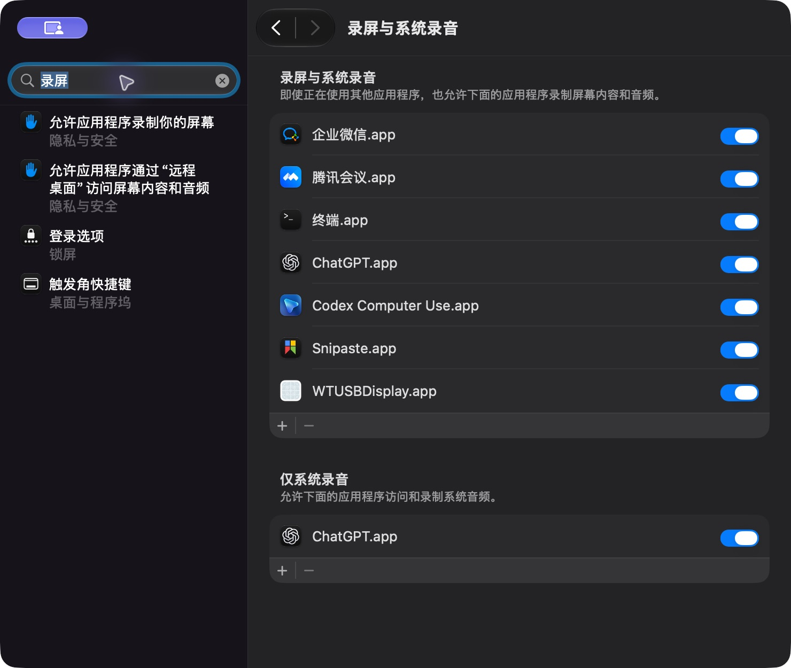
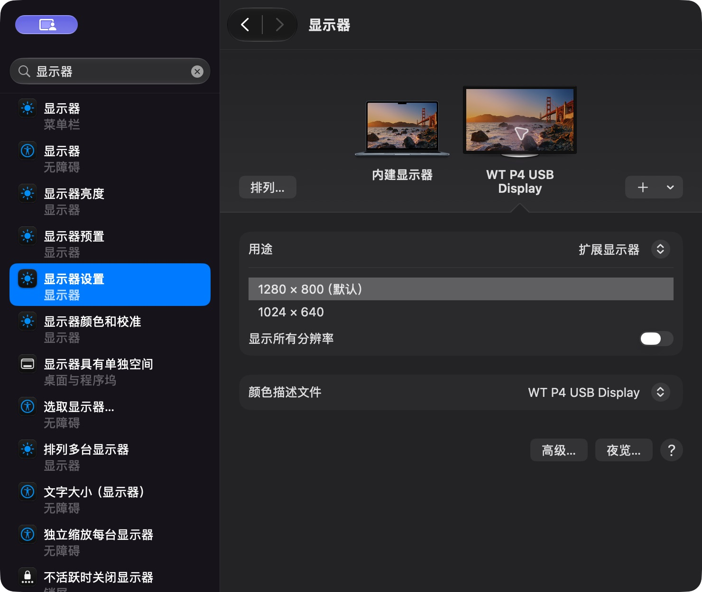

# macOS USB 扩展屏上位机

为 WT9932P4C61-TINY 与已适配的 800×1280 MIPI 屏创建真正的系统扩展桌面。
Mac 端显示模式为 **1280×800 横屏、60Hz 请求、HiDPI 关闭**，默认放在主屏右侧。
ScreenCaptureKit 只捕获这个新显示器，像素逆时针旋转为 **800×1280**，
以默认质量 **0.72** 编码为 baseline JPEG，经 USB 发送给 ESP32-P4 解码显示。

当前固件使用三个 RGB888/BGR24 帧缓冲。本模式仅传视频，**不提供 USB 触摸回传或音频**。
虚拟屏使用未公开的 CoreGraphics `CGVirtualDisplay` API，后续 macOS 版本需要重新验证。
程序不安装内核扩展、全局驱动或后台常驻服务。

## 环境与依赖

- 已实测：Apple Silicon M5 / arm64、macOS 27.2.1、Swift 6.4、libusb 1.0.30。
- 工程声明最低 macOS 13、Swift tools 5.9；这不代表所有旧系统或 Intel Mac 均已验证。
- 需要 Xcode 或 Xcode Command Line Tools，以及 Homebrew 提供的 `libusb`、`pkg-config`。
- App 动态链接本机 libusb；把 `.app` 复制到另一台机器时，该机器也需要此依赖。

以下安装操作由使用者在自己的 Mac 上执行；已安装的依赖可跳过：

```sh
xcode-select --install
brew install libusb pkg-config
```

## 克隆、构建与离线检查

```sh
git clone https://github.com/Wireless-TAG-Maker/WT_USB_Display.git
cd WT_USB_Display
bash host/macos/build.sh --test
```

构建产物为 `host/macos/build/WTUSBDisplay.app`，使用本机 ad-hoc 签名。
`build.sh` 只编译、打包和签名，不启动 App；`--test` 随后运行独立检查程序，
验证协议字节、CRC、分片 ACK、HELLO、JPEG 尺寸与实际像素旋转。
这些检查使用合成像素，不访问 USB、不创建显示器，也不请求录屏权限。
只需构建时可省略 `--test`。不需要下载 `vendor` 或原始屏幕资料目录。



## 接线与正常使用

先按[固件说明](../../firmware/README.md)烧录 `usb_display` 配置。
Mac 的视频数据线接开发板 **HUSB / USB High-Speed** 端口，并使用支持数据的线缆；
**FUSB** 用于供电、烧录或串口日志，不承载这里的视频流。USB 枚举必须为 high-speed。

在仓库根目录启动正常 App；重复启动前先退出已有实例：

```sh
open host/macos/build/WTUSBDisplay.app --args --fps 60 --quality 0.72
```

首次启动需要授予录屏权限，然后重新打开同一个 App：

1. 打开“系统设置 → 隐私与安全性 → 录屏与系统录音”（名称可能随系统版本变化）。
2. 在上方允许**屏幕与系统录音**的列表中开启 `WTUSBDisplay.app`；只开启下方的纯音频权限不够。
3. 若列表中没有它，使用 `+` / 添加按钮，选择当前仓库中已构建的
   `host/macos/build/WTUSBDisplay.app`，再开启开关。
4. 按系统提示退出并重新打开 App。将 Finder 等窗口拖到主屏右侧的新扩展屏即可使用。

App 实际只捕获新显示器，不默认捕获主屏，也不采集音频。
权限设置可参考 [Apple 官方说明](https://support.apple.com/guide/mac-help/control-access-screen-system-audio-recording-mchld6aa7d23/mac)。



授权后，在“系统设置 → 显示器”选择WT P4 USB Display，确认用途为扩展显示器、分辨率1280×800：



点击“排列…”可查看当前主屏与副屏位置。默认副屏位于主屏右侧；这里展示当前排列示例：


通过 App 菜单的 **Quit WT USB Display** 或 `⌘Q` 退出。
退出、SIGINT/SIGTERM、运行时限结束或连接错误会停止传输并移除虚拟屏；
虚拟屏消失后，由 macOS 重新安置其上的窗口。显示器排列仅用于当前会话。

## 重编译后的授权问题

ad-hoc 重编译可能改变系统用于识别程序的签名要求，因此旧的“已开启”开关未必适用于新产物。
先退出 App，再从权限列表移除旧条目、添加当前 `.app`，重新授权；成功后保持该产物不变。
若仍异常，可由使用者执行 Apple 提供的 `tccutil`，**仅重置本 App 的录屏决定**，再按上节重新授权：

```sh
tccutil reset ScreenCapture local.wirelesstag.WTUSBDisplay
```

此操作不会替你授权。不要省略 bundle ID 去重置其他程序，也不需要编辑 TCC 数据库或关闭 SIP。
参见 [Apple：重置受保护资源的访问权限](https://developer.apple.com/documentation/xcode/resetting-access-to-protected-resources-in-macos)。
命令行二进制与 `open` 启动可能具有不同的权限责任链；正常使用以 `open` 启动的 App 为准。

## 参数与诊断模式

以下命令均从仓库根目录执行；诊断结束后再打开正常 App，避免占用同一个 USB 设备：

```sh
APP=host/macos/build/WTUSBDisplay.app/Contents/MacOS/WTUSBDisplay
"$APP" --help
"$APP" --permission-check
"$APP" --probe
"$APP" --virtual-only --test-pattern --seconds 5
"$APP" --synthetic --fps 60 --quality 0.72 --seconds 30
```

| 参数 | 行为与副作用范围 |
| --- | --- |
| `--permission-check` | 只检查当前进程的既有录屏授权，不弹申请、不创建显示器、不访问 USB。 |
| `--probe` | 打开 USB，检查 high-speed 与 HELLO 后关闭；不创建显示器、不录屏。 |
| `--virtual-only` | 创建扩展屏，不访问 USB、不录屏；退出时移除，可能使桌面窗口重新排列。 |
| `--test-pattern` | 在新虚拟屏上打开全屏动态图案窗口；正常模式仍会录屏和传 USB，可与 `--virtual-only` 配合。 |
| `--synthetic` | 生成运动像素并传 JPEG/USB，会改变实体屏画面；不创建虚拟屏、不录屏、不需要录屏授权。 |
| `--seconds N` | 启动完成后运行 N 秒并清理退出，N 必须大于零。 |
| `--fps N` | 请求 1–60 FPS，默认 60；实际吞吐取决于源画面、系统调度、编码和设备。 |
| `--quality Q` | JPEG 质量 0.1–1，默认 0.72；影响压缩误差、编码负载与 USB 流量。 |

`--probe`、`--permission-check`、`--virtual-only`、`--synthetic` 只能选一种。
`--synthetic` 验证设备流链路，不能替代真实扩展桌面性能验证。

## 性能与日志的含义

流水线使用独立的捕获、编码、USB 写入与 ACK 读取任务；待处理帧只保留最新一帧，避免无限积压。
日志每秒报告 `capture_fps`、`encode_fps`、`sent_fps`、`present_ack_fps`，
并报告主机覆盖计数、拒绝计数、设备累计接收/解码/呈现计数和 USB 速度。
`drops_capture` / `drops_usb` 是有界队列覆盖量；`rejected` 提示需要检查 JPEG 大小或格式。
协议以[固件头文件](../../firmware/main/usb_screen_protocol.h)为准；测试 VID/PID 为 `CAFE:4011`。

在上述 M5 / macOS 27.2.1 上，以独立 Metal 运动图案、1280×800、60Hz 请求、质量 0.72、
当前 RGB888 固件及正常 `open` 启动的 App 测得：约 20.43 秒 CPU 窗口内 App **27.01%**、
WindowServer **38.91%**；同期 21 条报告的 presented-ACK 加权平均 **57.24 FPS**，范围 **56.9–58.1**。
CPU 的 100% 表示占满一个核心。该采样窗口主机覆盖和设备错误均为零；启动阶段另有 USB 覆盖记录。
这些结果仅适用于该场景，不保证所有桌面内容或机器的性能。
ACK 是设备呈现完成计数派生的吞吐，**不是独立光学帧率**；60Hz 请求、合成模式或 LVGL benchmark
均不能直接证明真实桌面帧率。长期稳定性与物理热插拔恢复仍需更多验证。

## 第三方许可

虚拟显示接口声明与创建方式参考 MIT 许可的 glint；版权和许可保存在
[GLINT-LICENSE](GLINT-LICENSE) 与 [THIRD_PARTY_NOTICES.md](THIRD_PARTY_NOTICES.md)。
libusb 使用 LGPL-2.1-or-later，由本机系统包单独提供。
